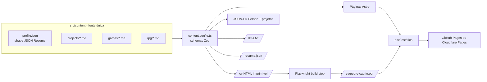

# Design técnico — Site Currículo/Portfólio

Fase 2 do Spec-Driven Development. Decisão de stack registrada em [ADR-001](../decisions/ADR-001-stack.md).

## Arquitetura



## Estrutura de pastas planejada

```
/
├─ AGENTS.md
├─ astro.config.mjs
├─ package.json
├─ public/                 # favicon, og.png, robots.txt
├─ docs/                   # esta documentação
├─ scripts/
│  └─ build-pdf.ts         # Playwright: /cv → PDF
├─ tests/
│  ├─ e2e/                 # Playwright (R-xx nos nomes)
│  └─ a11y/                # axe
├─ .cursor/
│  ├─ rules/               # regras por escopo
│  └─ skills/              # verify-in-browser, add-project
└─ src/
   ├─ content.config.ts    # collections + schemas Zod
   ├─ content/
   │  ├─ profile.json
   │  ├─ projects/*.md
   │  ├─ games/*.md
   │  └─ rpg/*.md
   ├─ i18n/                # strings de UI (pt, en)
   ├─ styles/
   │  ├─ tokens.css        # DESIGN.md em CSS variables
   │  └─ global.css        # @import "tailwindcss"; @theme
   ├─ components/
   │  ├─ ui/               # Button, Tag, Card, SectionHeading
   │  ├─ sections/         # Hero, About, Experience, Projects, Games, Rpg, Skills, Contact
   │  └─ islands/          # CommandPalette (único JS de cliente)
   ├─ layouts/
   │  ├─ BaseLayout.astro  # head, SEO, JSON-LD, fontes
   │  └─ CvLayout.astro    # CSS de impressão, coluna única
   ├─ lib/
   │  ├─ jsonld.ts         # funções puras
   │  ├─ llms.ts
   │  └─ resume.ts         # profile → JSON Resume
   └─ pages/
      ├─ index.astro
      ├─ projetos/[slug].astro
      ├─ jogos/[slug].astro
      ├─ cv.astro
      ├─ como-foi-feito.astro
      ├─ llms.txt.ts
      ├─ resume.json.ts
      └─ 404.astro
```

## Rotas

| Rota | Conteúdo | Requisitos |
| --- | --- | --- |
| `/` | Hero, Sobre, Experiência, Projetos, Jogos, RPG, Skills, Contato (one-page com âncoras) | R-01..R-08 |
| `/projetos/[slug]` | Estudo de caso | R-04, R-21 |
| `/jogos/[slug]` | Detalhe do jogo (só destaques) | R-05, R-21 |
| `/cv` | Currículo HTML imprimível | R-10 |
| `/cv/pedro-caurio.pdf` | PDF gerado | R-09 |
| `/como-foi-feito` | Processo SDD + agentes | R-12 |
| `/llms.txt`, `/resume.json` | Máquina | R-22 |
| `/en/...` | Espelho em inglês (se aprovado) | R-13 |

## Modelo de conteúdo (schemas)

```ts
// profile.json — subconjunto do JSON Resume
basics: { name, label, email, url, summary, location: { city, region, countryCode },
          profiles: [{ network, username, url }] }
work: [{ name, position, startDate, endDate?, summary, highlights: string[] }]
education: [{ institution, area, studyType, startDate, endDate?, score? }]
skills: [{ name, keywords: string[] }]
languages: [{ language, fluency }]

// projects/*.md (frontmatter)
title, slug, summary, role, period, featured: boolean, order: number,
stack: string[], links: { repo?, demo?, docs? }, confidential: boolean,
cover?: image, problem, constraints, decision, result   // corpo em Markdown

// games/*.md (frontmatter)
title, slug, summary, engine, genre: string[], role, team: [{ name, role }],
jam?: { name, year, result? }, status, itchUrl, repo?, playableInBrowser: boolean,
cover: image, loop?: video, featured: boolean, order: number

// rpg/*.md
title, kind: 'sistema' | 'campanha', summary, mechanics: string[], links?
```

Campos `pt`/`en` por idioma serão resolvidos com collections separadas por locale (`content/pt/`, `content/en/`) se R-13 for aprovado.

## Interatividade

Único JS de cliente: `CommandPalette` (vanilla TS, carregado com `client:idle`). Vídeos de gameplay usam `<video autoplay muted loop playsinline preload="none">` com poster e pausam fora da viewport (IntersectionObserver inline pequeno) e com `prefers-reduced-motion`.

## Geração do PDF

`scripts/build-pdf.ts` roda após `astro build`: sobe `astro preview`, abre `/cv` no Chromium do Playwright, `page.pdf({ format: 'A4', printBackground: false })`, salva em `dist/cv/`. O CSS de `CvLayout` é coluna única, fundo branco, texto preto, sem ícones substituindo palavras (regras ATS do [doc 03](../research/03-curriculo-ats.md)).

## Verificação (CI)

```
npm run check     # astro check + tsc + eslint
npm run build     # astro build + build-pdf
npm run test      # playwright e2e + axe (390px e 1280px)
npm run lhci      # Lighthouse CI com orçamentos de N-01/N-02
```

GitHub Actions: roda tudo em PR; em `main`, publica.
