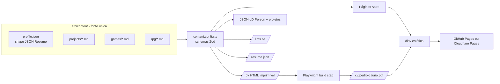

# Design técnico — Site Currículo/Portfólio

Fase 2 do Spec-Driven Development. Decisão de stack registrada em [ADR-001](../decisions/ADR-001-stack.md).

## Arquitetura



## Estrutura de pastas planejada

```
/
├─ AGENTS.md
├─ astro.config.mjs
├─ package.json
├─ public/                 # favicon, og.png, robots.txt
├─ docs/                   # esta documentação
├─ scripts/
│  └─ build-pdf.ts         # Playwright: /cv → PDF
├─ tests/
│  ├─ e2e/                 # Playwright (R-xx nos nomes)
│  └─ a11y/                # axe
├─ .cursor/
│  ├─ rules/               # regras por escopo
│  └─ skills/              # verify-in-browser, add-project
└─ src/
   ├─ content.config.ts    # collections + schemas Zod
   ├─ content/
   │  ├─ profile.json
   │  ├─ projects/*.md
   │  ├─ games/*.md
   │  └─ rpg/*.md
   ├─ i18n/                # strings de UI (pt, en)
   ├─ styles/
   │  ├─ tokens.css        # DESIGN.md em CSS variables
   │  └─ global.css        # @import "tailwindcss"; @theme
   ├─ components/
   │  ├─ ui/               # Button, Tag, Card, SectionHeading
   │  ├─ sections/         # Hero, About, Experience, Projects, Games, Rpg, Skills, Contact
   │  └─ islands/          # CommandPalette (único JS de cliente)
   ├─ layouts/
   │  ├─ BaseLayout.astro  # head, SEO, JSON-LD, fontes
   │  └─ CvLayout.astro    # CSS de impressão, coluna única
   ├─ lib/
   │  ├─ jsonld.ts         # funções puras
   │  ├─ llms.ts
   │  └─ resume.ts         # profile → JSON Resume
   └─ pages/
      ├─ index.astro
      ├─ projetos/[slug].astro
      ├─ jogos/[slug].astro
      ├─ cv.astro
      ├─ como-foi-feito.astro
      ├─ llms.txt.ts
      ├─ resume.json.ts
      └─ 404.astro
```

## Rotas

| Rota | Conteúdo | Requisitos |
| --- | --- | --- |
| `/` | Portfólio profissional: Hero, Sobre, Experiência, Projetos, Como eu trabalho, Habilidades (`track: professional`), chamada para Jogos & RPG, Contato | R-01..R-04, R-07, R-08, R-12 |
| `/jogos/` | Jogos & RPG: hero próprio, Jogos, Ficha de personagem (todas as skills com atributo), Mesa de RPG, Contato | R-05, R-06 |
| `/projetos/[slug]` | Estudo de caso (`ProjectPage.astro`): ficha técnica, corpo em Markdown com índice, equipe, stack, links, anterior/próximo | R-04, R-21 |
| `/projetos/portfolio/` | Estudo de caso deste site: processo SDD, harness de agentes, verificação (substitui `/como-foi-feito`) | R-12 |
| `/jogos/[slug]` | Ficha do jogo (só destaques, `GamePage.astro`) | R-05, R-21 |
| `/cv` | Currículo HTML imprimível | R-10 |
| `/cv/pedro-caurio.pdf` | PDF gerado | R-09 |
| `/llms.txt`, `/resume.json` | Máquina | R-22 |
| `/en/...` | Espelho em inglês | R-13 |
| `/dev/tokens`, `/dev/conteudo` | Páginas internas de verificação (noindex, fora do sitemap) | — |

## Modelo de conteúdo (implementado)

Fonte de verdade: [`src/content.config.ts`](../../src/content.config.ts). Resumo:

| Coleção | Arquivo | Campos principais |
| --- | --- | --- |
| `profile` | `profile.yaml` | name, fullName, label\*, summary\*, email, profiles[], rpgMasterYears |
| `experience` | `experience.yaml` | organization, url, position\*, employment\*, startDate?, endDate?, confidential, summary\*, highlights\*[], tags\*[] |
| `education` | `education.yaml` | institution, shortName, area\*, studyType\*, startDate?, endDate?, expected, score? |
| `skills` | `skills.yaml` | attribute\* (ficha de RPG), name\*, track (`professional`\|`play`), keywords\*[] |
| `games` | `games.yaml` | title, engine, language, genre\*, summary\*, role\*, contributions\*[], evidence\*[]?, team[], jam?{name, awards\*[]}, noGenerativeAi, links{itch, repo?}, playableInBrowser, featured, order, coverFit (`cover`\|`contain`; capa em `src/assets/games/<id>.png`) |
| `projects` | `projects/{pt,en}/<slug>.md` | title, summary, role, context?, team[]{name, url?}, facts[]{label, value}, stack[], links, confidential, draft, featured, order + corpo (estudo de caso, `##` vira item do índice) |
| `rpg` | `rpg.yaml` | title, kind, status\*, summary\*?, draft |

\* campo localizado `{ pt, en }`. Helpers em `src/i18n/index.ts` (`localize(campo, locale)`). Datas em `AAAA-MM`. Entradas `draft: true` não são publicadas nas páginas finais.

Mídia (covers e loops de gameplay) entra como campos opcionais quando os arquivos existirem.

## Interatividade

Único JS de cliente: `CommandPalette` (vanilla TS, carregado com `client:idle`). Vídeos de gameplay usam `<video autoplay muted loop playsinline preload="none">` com poster e pausam fora da viewport (IntersectionObserver inline pequeno) e com `prefers-reduced-motion`.

## Geração do PDF

`scripts/build-pdf.ts` roda após `astro build`: sobe `astro preview`, abre `/cv` no Chromium do Playwright, `page.pdf({ format: 'A4', printBackground: false })`, salva em `dist/cv/`. O CSS de `CvLayout` é coluna única, fundo branco, texto preto, sem ícones substituindo palavras (regras ATS do [doc 03](../research/03-curriculo-ats.md)).

## Verificação (CI)

```
npm run check     # astro check + tsc + eslint
npm run build     # astro build + build-pdf
npm run test      # playwright e2e + axe (390px e 1280px)
npm run lhci      # Lighthouse CI com orçamentos de N-01/N-02
```

GitHub Actions: roda tudo em PR; em `main`, publica.
